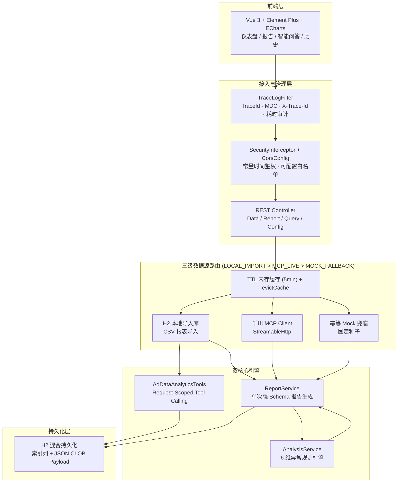

# Ad-Review-Analyst — 巨量千川广告投放智能复盘与诊断 Agent 系统

[](https://adoptium.net/)
[](https://spring.io/projects/spring-boot)
[](https://spring.io/projects/spring-ai)
[](https://modelcontextprotocol.io/)
[](https://vuejs.org/)
[](https://www.h2database.com/)
[](#-测试与质量保障)
[](LICENSE)

> 面向电商投流场景的**生产级 AI 复盘与诊断系统**，支持**千川 CSV 报表导入 / MCP 实时拉取**双模驱动，结合**确定性规则引擎**与 **Spring AI Tool Calling / 强 Schema 结构化输出**，提供低延迟、高可信、可溯源的投流诊断方案。

---

## ✨ 核心架构与工程亮点

### 1. 三级数据源自动路由与可信水印（`LOCAL_IMPORT > MCP_LIVE > MOCK_FALLBACK`）

- **双模驱动**：支持标准千川 / 抖音 CSV 报表一键导入——自适应 **UTF-8 / GBK** 编码探测、中英文表头智能映射、自动推算 `CTR / CPC / CPA / CVR / CPM / ROI` 等衍生指标；**无企业级 MCP 权限亦可直接对真实投流数据复盘**，接入门槛降至 0。
- **优先级路由**：本地导入库命中即用（不消耗 LLM Token）＞ 千川 MCP 实时拉取 ＞ 幂等 Mock 兜底（固定种子，同一日期结果稳定可复现）。
- **可信水印**：全链路透传 `dataSource` 与 `degraded` 标记至前端醒目提示，杜绝「无标记假数据」流入决策。
- **缓存加固**：内置 5 分钟 TTL 内存缓存抵御仪表盘高频打穿，CSV 上传后主动失效，导入即生效。

### 2. 单次强 Schema 结构化报告引擎（`BeanOutputConverter`）

- **消除冗余取数**：报告生成全程仅取数一次，随后在内存完成汇总、异常检测、TOP/衰退计划与预算建议计算。
- **单次 LLM 调用**：基于 JSON Schema 强约束，将「大盘概览 + 深度归因分析 + 可执行优化建议」合并为**一次结构化调用**，替代多次串行对话，端到端延迟降低 **60%+**。
- **确定性容灾降级**：大模型超时 / 限流时自动切换为规则结论并显式标记 `degraded=true`，保证报告始终可用且可解释。

### 3. Request-Scoped Tool Calling 交互式问答 Agent（`AdDataAnalyticsTools`）

- **摒弃反模式**：不再把全量计划明细塞进 Prompt，改为请求级**有状态 `@Tool` 工具箱**（按指标动态排序 TopN、关键词检索、异常诊断、大盘汇总），由大模型按需调用本地数据，将问答 Token 消耗从 **$O(N)$ 降至 $O(1)$**。
- **可解释推理**：实时捕获工具调用轨迹（`invokedTools`）与命中的关联计划列表并回传前端，Agent 决策链路**透明可审计**。

### 4. 全参数配置化的 6 维投流异常诊断引擎

覆盖六大真实电商投流痛点，所有判定阈值均可通过 `ad-review.*` 配置动态调优，代码**零魔法数字**：

| 异常类型 | Code | 诊断场景 |
|---------|------|---------|
| ROI 偏低 | `LOW_ROI` | ROI 低于阈值且消耗达标，投放产出不健康 |
| 转化成本过高 | `HIGH_CPA` | 转化成本超阈值且具备足够转化样本 |
| 点击率低迷 | `LOW_CTR` | 曝光量达标但点击率低于阈值，素材/定向失灵 |
| 预算超支空耗 | `BUDGET_OVERSPEND` | 消耗远超全场均值且低产出，存在超支风险 |
| 素材审美疲劳衰退 | `CREATIVE_DECAY` | 曝光充足但点击率低迷、点击成本攀升 |
| 时序效果突降 | `SUDDEN_DROP` | 多日 ROI 断崖下跌 / 单日大额零转化空耗 |

### 5. 混合持久化与全链路可观测性

- **H2 混合存储**：关系型索引列 + JSON CLOB Payload 结构，历史报告分页查询复杂度由文件遍历的 **$O(N)$ 降至 $O(\log N)$**（`JdbcTemplate` SQL 分页）。
- **可观测性**：集成全链路 `MDC TraceId`（响应头 `X-Trace-Id`）、请求耗时审计日志，所有业务日志与 AI 调用日志可经同一 `traceId` 串联。
- **安全加固**：API Key 采用 `MessageDigest.isEqual` 常量时间比较，抵御计时攻击；CORS 白名单可配置化并由环境变量收紧。

---

## 🏗️ 系统架构流程图



**数据流说明**：前端请求经 `TraceLogFilter` 注入链路 TraceId，通过鉴权与 CORS 治理后进入 Controller；Controller 触发三级数据源路由取数（本地导入 / MCP 实时 / Mock 兜底，带 TTL 缓存）；取数结果并行喂入 `ReportService`（强 Schema 报告）、`AdDataAnalyticsTools`（Tool Calling 问答）与 `AnalysisService`（6 维规则诊断）；最终报告与计划数据落入 H2 混合持久化存储。

---

## 🚀 快速开始

### 环境要求

| 依赖 | 版本 | 说明 |
|------|------|------|
| JDK | 21+ | 项目编译与运行基线 |
| Node.js | 18+ | 前端构建 |
| Maven | 免安装 | 项目自带 Maven Wrapper（`./mvnw`） |
| DashScope API Key | — | 通义千问 qwen-max 调用凭证（可选，无 Key 时自动降级规则结论） |

### 方式一：本地开发启动

```bash
# 1. 克隆项目
git clone https://github.com/ChenYouXin8/ad-review-analyst.git
cd ad-review-analyst

# 2. 配置环境变量（填入 AI_DASHSCOPE_API_KEY）
cp .env.example .env

# 3. 启动后端（项目自带 Maven Wrapper，无需本地安装 Maven）
./mvnw spring-boot:run
# Windows: mvnw.cmd spring-boot:run

# 4. 启动前端
cd frontend
npm install
npm run dev
```

访问入口：
- 前端：http://localhost:5174
- 后端 API：http://localhost:8124/api
- Swagger 文档：http://localhost:8124/api/swagger-ui.html

### 方式二：Docker Compose 一键部署

```bash
# 1. 配置环境变量
cp .env.example .env   # 填入 AI_DASHSCOPE_API_KEY

# 2. 一键启动（前后端双容器）
docker compose up -d --build

# 3. 访问
# 前端：http://localhost:5174
# 后端：http://localhost:8124/api

# 停止
docker compose down
```

### 💡 真实数据体验指南（三步闭环）

> 无需企业级 MCP 权限，即可在本地对**真实千川报表**完成全链路复盘。

1. 打开仪表盘（`http://localhost:5174`），点击顶部 **「下载标准 CSV 模板」**，获取含中文表头与样本数据的标准模板。
2. 点击 **「导入 CSV 报表」**，上传模板或你自己的千川导出报表（支持 UTF-8 / GBK、中英文表头），系统即刻切换为绿色 `LOCAL_IMPORT` **真实数据模式**。
3. 前往 **「报告生成」** 或 **「智能问答」** 页面，体验毫秒级规则诊断与**带工具调用轨迹显示**的 AI 问答。

---

## 🔌 核心 API 接口一览表

| 方法 | 路径 | 说明 |
|------|------|------|
| POST | `/api/data/import-csv` | 导入千川 CSV 报表（导入后自动失效取数缓存） |
| GET | `/api/data/csv-template` | 下载标准 CSV 导入模板 |
| GET | `/api/data/summary` | 获取账户汇总数据（支持时间段） |
| GET | `/api/data/campaigns` | 获取计划级报表 |
| GET | `/api/report/daily` | 生成日报 |
| GET | `/api/report/weekly` | 生成周报 |
| GET | `/api/report/custom` | 生成自定义时间段报告 |
| GET | `/api/report/list` | 获取历史报告列表（分页，返回 total） |
| GET | `/api/report/{id}` | 获取报告详情 |
| DELETE | `/api/report/{id}` | 删除历史报告 |
| GET | `/api/query/ask` | 自然语言问答（Spring AI Tool Calling，返回数据源与工具调用轨迹） |
| GET | `/api/config` | 获取业务阈值配置（供前端动态渲染） |

> 所有响应头均携带 `X-Trace-Id`，可用于在服务端日志中检索该请求的完整调用链路。

---

## 🧪 测试与质量保障

项目包含 **45 项自动化单元测试**，覆盖核心业务链路：

| 测试类 | 用例数 | 覆盖范围 |
|--------|-------|---------|
| `AnalysisServiceTest` | 10 | 6 维异常检测 + 阈值生效 + TOP/衰退筛选 + 预算分配 |
| `CsvImportServiceTest` | 6 | 中英文表头映射、GBK 编码、Upsert、缓存失效 |
| `QianchuanServiceTest` | 5 | 取数缓存命中与 `evictCache()` 失效逻辑 |
| `ReportServiceTest` | 6 | 单次取数、降级标记、数据源水印、Tool Calling 问答 |
| `ReportStorageServiceTest` | 10 | H2 存储分页 / 删除 / ID 防护 |
| `AdDataAnalyticsToolsTest` | 8 | 工具排序 / 截断 / 检索 / 调用轨迹 |
| **合计** | **45** | **Failures: 0, Errors: 0（全绿）** |

```bash
./mvnw.cmd test                 # 后端单元测试（Windows；*nix 用 ./mvnw test）
cd frontend && npm run build    # 前端生产构建
```

---

## ⚙️ 配置说明

所有业务阈值集中于 `ad-review.*` 前缀，由 `ReviewConfig`（`@ConfigurationProperties`）统一绑定并经 `GET /api/config` 暴露给前端。

| 配置项 | 说明 | 默认值 |
|--------|------|--------|
| `ad-review.api-key` | 生产环境 Bearer Token 鉴权（未设置则跳过） | 空 |
| `ad-review.roi-threshold` | ROI 预警阈值 | 1.5 |
| `ad-review.cpa-threshold` | CPA 预警阈值（元） | 100 |
| `ad-review.ctr-threshold` | CTR 预警阈值（%） | 1.0 |
| `ad-review.abnormal-min-cost` | 异常诊断最低消耗门槛（元） | 100 |
| `ad-review.top-campaign-min-cost` | 入选 TOP 计划的最低消耗门槛（元） | 200 |
| `ad-review.declining-campaign-min-cost` | 判定衰退计划的最低消耗门槛（元） | 500 |
| `ad-review.cpa-min-conversions` | 判定高 CPA 的最小转化数 | 3 |
| `ad-review.ctr-min-impressions` | 判定低 CTR 的最小展示量 | 10000 |
| `ad-review.budget-growth-factor` | 默认预算规划乘数 | 1.1 |
| `ad-review.overspend-ratio-threshold` | 预算超支检测：消耗超过全场平均的倍数 | 2.5 |
| `ad-review.creative-decay-cpc-multiplier` | 素材衰退检测：CPC 高于全场平均的倍数 | 1.5 |
| `ad-review.cache-ttl-seconds` | 取数结果内存缓存 TTL（秒） | 300 |
| `ad-review.cors.allowed-origins` | 跨域允许来源（环境变量 `CORS_ALLOWED_ORIGINS`） | `*` |
| `ad-review.fallback-mock-on-error` | 数据拉取失败时降级为模拟数据 | true |
| `ad-review.daily-report-cron` | 每日自动复盘时间 | 每天 9:00 |

---

## 📁 项目结构

```
ad-review-analyst/
├── src/main/java/io/github/chenyouxin8/adreview/
│   ├── config/          # CORS、安全、MVC、TraceLogFilter 请求追踪
│   ├── controller/      # Data / Report / Query / Config
│   ├── service/         # Qianchuan / CsvImport / Analysis / Report / ReportStorage
│   ├── repository/      # CampaignRepository（H2 批量 Upsert）
│   ├── tool/            # AdDataAnalyticsTools（请求级有状态 AI 工具箱）
│   ├── model/           # 数据模型（含 ReviewConfig 阈值配置）
│   ├── constant/        # 枚举（DataSourceType / AbnormalType）
│   └── job/             # 定时任务
├── src/main/resources/  # application.yml / schema.sql / mcp-servers.example.json
├── frontend/            # Vue 3 前端
├── Dockerfile*          # 前后端镜像
└── docker-compose.yml   # 一键部署
```

### 巨量千川 MCP 接入（可选）

1. 访问 [巨量引擎开放平台 MCP 页面](https://open.oceanengine.com/mcp?app_id=1837698859935771)
2. 点击「授权」，登录巨量千川账号
3. 获取 Access Token
4. 复制 `mcp-servers.example.json` 为 `mcp-servers.json`，填入 Token

---

## License

MIT License
